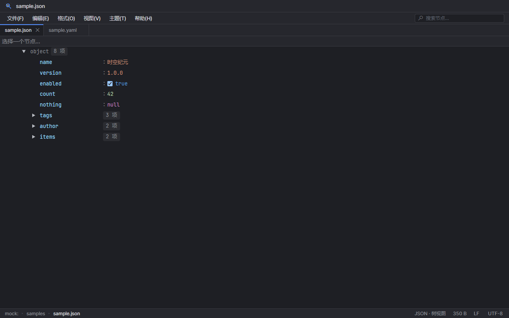

# CaDt-DataLens

> 轻量的 Windows 多格式数据查看与编辑器。
> A lightweight multi-format data viewer and editor for Windows, built with Wails and jsoneditor.



CaDt-DataLens 用桌面窗口打开 JSON、JSONL、YAML、XML、CSV 和普通文本，不依赖浏览器，不上传文件，所有读写都在本机完成。

## 功能

### 格式与视图

- 结构化格式：JSON / JSONC / JSON5、JSONL / NDJSON、YAML / YML、XML / SVG、CSV / TSV、TOML、INI / Properties。
- JSONL 按行解析为数组显示，树视图编辑后仍按“一行一个 JSON 值”保存。
- 文本格式：txt、log、conf、html、css、js、ts、py、go、java、sql 等。
- Markdown 文件默认打开预览：标题、列表、表格、引用、代码块和 KaTeX 行内/块级公式；代码块按当前主题高亮，行号可在设置中开启（默认关闭）。预览只读，可切回代码/文本视图编辑。原始 HTML 不执行，外部链接交给系统浏览器打开。
- 多种视图：
  - **树视图**：展开/收起节点，直接编辑键和值。
  - **代码视图**：Ace 编辑器，带行号、语法高亮、括号匹配。按扩展名启用 YAML、XML/SVG、JS/TS、Python、Markdown、HTML/CSS、Shell/PowerShell/Batch、Go/Java/Kotlin/Lua/SQL、TOML/INI/Properties 等语法模式。折叠区显示与树视图一致的预览（JSON 对象首项、数组元素数，内容过长时按显示宽度截断，其他格式显示首行内容）；hover 折叠区会弹出带原始行号和语法高亮的完整折叠内容，树视图不显示该 hover 预览。
  - **文本视图**：纯文本编辑框，适合看原始内容和最简单的文本修改。
  - **预览**（Markdown）：只读渲染；支持代码块语法高亮和数学公式。
  - **表格视图**（CSV / TSV）：冻结表头与行号，拖动表头边缘可调整列宽；点击单元格直接编辑（Enter 确认并下移、Tab 换格、Esc 取消），支持撤销/重做；超过 5000 行时只预览前 5000 行，编辑仍会保留全部行。
- 每个格式可单独配置默认视图，修改后对当前同类文件立即生效。
- 代码视图支持自动换行开关（设置 → 通用设置或视图菜单），默认关闭，长行横向滚动。缩进参考线默认关闭，可在设置 → 通用设置开启。IDEA Dark 下 Python 取色对齐 PyCharm：方法/属性调用用正文色，内置函数与关键字参数用橙色。
- 状态栏右下角提供只读锁定：默认解锁；点击后所有打开和之后打开的文件都变为只读，树编辑、代码/文本输入、表格单元格编辑、保存和格式化均被阻止，再点一次解锁恢复。
- 大文件、二进制、解析失败等顶部提示条右侧可点 `×` 关闭当前文件的提示；设置 → 通用设置可全局关闭“显示顶部提示条”。
- 图片文件默认显示图片视图，右下角视图菜单可切到二进制视图；按扩展名/文件头识别，直接预览上限 32 MB。图片视图支持 `Ctrl+滚轮` 缩放，点击 footer 比例可选自动适配或常用比例（25%–800%），双击恢复适配大小；超出视图时可拖动平移。其他含 NUL 或大量控制字符的文件（如 `.bin`）按二进制处理，只读十六进制视图超过 1 MB 只显示前 1 MB 并在顶部提示。
- 未识别的扩展名按纯文本打开。
- 大于 10 MB 的文件切换为只读代码模式；大于 100 MB 拒绝打开。

### 编辑与文件

- 新建、打开、保存、另存为、保存全部、重新加载、关闭标签。
- 撤销/重做；内容恢复到原版后会自动清除“未保存”标记。
- 文件未编辑时，代码/文本视图保留磁盘原文格式；未修改直接保存也不会重排格式。
- 关闭有未保存修改的标签或窗口时确认。
- 自动保存开关：停止输入 1 秒后静默保存当前文件。
- 打开文件位置、复制文件路径/文件名。
- 拖入一个或多个文件即可打开；支持文件对话框多选，也可以直接打开文件夹。
- 文件侧边栏（`Alt+1`）：列表视图列出当前文件所在目录的数据文件，超过 200 个时提示改用文件树视图；文件树视图按 IDE 风格懒加载目录。单击只选中，选中项为圆角高亮，连续多选合并为一整块（仅首尾圆角）；单击目录前的箭头可展开/收起，双击打开文件或展开/收起目录，`Ctrl+单击` 可多选文件/目录，`Shift+单击` 从上次锚点连续选择，`Ctrl+Shift+单击` 追加一段范围；选中单个文件或目录后可按 `F2` / `Shift+F6` 重命名，多选后可批量复制、剪切、粘贴。当前打开文件不再额外加背景高亮。缩进参考线默认关闭，可在通用设置中开启。文件树/列表默认每 3 秒自动同步一次，切回应用时立即刷新；可在通用设置调整间隔或关闭。折叠对象/数组显示带主题底色的 IDEA 式预览（IDEA Light 为浅绿底）：对象显示首项键值对（如 `{"id": "..."...}`），数组显示 `[ N 个元素... ]`，预览与字段垂直居中，点击预览即可展开；展开行只保留低调的项数。
- 左侧工具条：IDEA 风格竖向工具窗口栏，文件树左边常驻显示；包含文件树开关、节点搜索、视图/工具窗口“更多”、只读锁、主题、设置和关于。文件树开关与底部状态栏按钮状态同步。
- 右键菜单：标签页可关闭/关闭其他/全部/左侧/未修改、复制路径、在新窗口打开、重新打开关闭的标签页；侧边栏目录可新建常见格式文件（JSON / TXT / Markdown / YAML / XML / CSV / TOML / JSONL / INI / Properties 及常用代码文件）或文件夹，文件和目录都可复制、剪切、粘贴、重命名；粘贴到同名位置时会先给出“名称 - 副本”建议再确认；复制路径子菜单提供绝对路径、相对当前打开目录的路径（不带 `./`）和文件名；代码/文本内容区可剪切复制粘贴、查找、格式化、重新加载、折叠。
- 设置 → 系统集成：可把当前程序注册到注册表（加入 JSON/JSONL/YAML/XML/CSV/文本等格式的“打开方式”）和资源管理器右键菜单（文件/文件夹/文件夹空白处）；只写 HKCU，无需管理员权限，默认程序仍需在 Windows 中确认。
- UTF-8 / GBK / GB18030 / ISO-8859-1 / US-ASCII 编码，自动检测；保留原文件换行符与 UTF-8 BOM。
- 大文件与二进制文件自动只读。

### 外观

- 10 套配色：深色、浅色、Darcula、IDEA Dark、IDEA Light、Github、Newsprint、Night、Pixyll、Whitey。
- 内置字体：Inter、JetBrains Mono、Fira Code。
- 界面字体、编辑器字体、界面中文字体、编辑器中文字体可分别选择，并带实时预览。
- 固定键列与键列宽度可调。
- 编辑器字号 9–24，可用 `Ctrl+滚轮` 调整。
- 文件树字号 10–20（步进 0.5）可单独设置，只影响左侧文件列表/目录树。
- 所有设置本地持久化。

### 多文件

- **单窗口标签页**：类似代码编辑器的多标签体验，每个标签保留自己的视图、滚动位置和撤销历史。
- **多窗口**：每个文件使用独立窗口；适合并排对照多个文件。
- 在设置 → 通用设置 → “多文件打开”中切换。

## 快捷键

| 操作 | 快捷键 |
| --- | --- |
| 新建 | `Ctrl+N` |
| 新建窗口 | `Ctrl+Shift+N` |
| 打开 | `Ctrl+O` |
| 保存 | `Ctrl+S` |
| 另存为 | `Ctrl+Shift+S` |
| 关闭标签 | `Ctrl+W` |
| 设置 | `Ctrl+,` |
| 撤销 / 重做 | `Ctrl+Z` / `Ctrl+Y` |
| 格式化 | `Ctrl+Alt+L` |
| 文件侧边栏 | `Alt+1` |
| 文件树中打开文件 / 展开目录 | 双击 |
| 文件树中选择 / 多选 | 单击 / `Ctrl+单击` |
| 文件树中连续选择 / 追加范围 | `Shift+单击` / `Ctrl+Shift+单击` |
| 文件树中重命名 | `F2` / `Shift+F6` |
| 文件树中复制 / 剪切 / 粘贴 | `Ctrl+C` / `Ctrl+X` / `Ctrl+V` |
| 重新打开关闭的标签页 | `Ctrl+Shift+T` |
| 当前文件在新窗口打开 | `Shift+F4` |
| 搜索节点 | `Ctrl+F`（树视图） |
| 展开 / 收起节点 | `Ctrl+=` / `Ctrl+-` |
| 全部展开 / 收起 | `Ctrl+Shift+=` / `Ctrl+Shift+-` |
| 调整编辑器字号 | `Ctrl+滚轮` |
| 标签栏横向滚动 | 鼠标滚轮悬停在标签栏 |

## 命令行

支持直接指定文件和行号，打开后切到代码视图（CSV 为文本视图）并整行选中：

```bat
CaDt-DataLens.exe "D:\data\sample.json:42"
CaDt-DataLens.exe "D:\data\sample.json:42:8"
CaDt-DataLens.exe "D:\data\sample.json" --line 42
CaDt-DataLens.exe --line 42 "D:\data\sample.json"
CaDt-DataLens.exe -g "D:\data\sample.json:42"
```

- 行、列从 1 开始；列可省略。
- 支持 `--line/-l`、`--column/-c`、`--goto/-g`。
- 可一次传多个文件；图片和二进制文件会忽略行号。
- 程序已在运行时，新命令会转发到现有窗口并定位。

## 支持的文件类型

| 类型 | 扩展名 | 默认处理 |
| --- | --- | --- |
| JSON | `.json` `.jsonc` `.json5` | 树视图 / 代码视图 / 文本视图 |
| JSONL | `.jsonl` `.ndjson` | 树视图 / 代码视图 / 文本视图 |
| YAML | `.yaml` `.yml` | 树视图 / 代码视图 / 文本视图 |
| XML | `.xml` `.svg` | 树视图 / 代码视图 / 文本视图 |
| CSV | `.csv` `.tsv` | 表格视图 / 树视图 / 文本视图 |
| TOML | `.toml` | 树视图 / 代码视图 / 文本视图 |
| INI/Properties | `.ini` `.properties` `.cfg` | 树视图 / 代码视图 / 文本视图 |
| Markdown | `.md` `.markdown` | 预览 / 代码视图 / 文本视图 |
| 文本 | `.txt` `.log` `.conf` `.html` `.css` `.js` `.ts` `.py` `.go` `.java` `.sql` 等 | 代码视图 |
| 图片 | `.png` `.jpg` `.jpeg` `.gif` `.bmp` `.webp` `.ico` `.tif` `.tiff` `.avif` `.heic` `.psd` 等 | 图片视图 / 二进制视图 |
| 其他 | 任意扩展名 | 文本按纯文本；含 NUL/大量控制字符按只读十六进制 |

## 示例数据

`docs/samples/` 按格式提供可直接打开的合成示例，说明见 [示例说明](docs/samples/README.md)。包含 12 层嵌套 JSON、JSONL 逐行记录、约 211 KB / 4944 个方块的长蓝图、长日志、CSV、SVG、TOML/INI 配置、带代码块和数学公式的 Markdown 示例，以及 PNG/JPEG/GIF/BMP/WebP/ICO/TIFF/AVIF 和原始字节等二进制样本。

## 构建

前置条件：

- Windows 10/11（需要 WebView2 Runtime）。
- Go 1.26+。
- Node.js 20.19+（或 22.12+）。
- Wails CLI v2.17.1+。

```bash
go install github.com/wailsapp/wails/v2/cmd/wails@v2.17.1
git clone https://github.com/candysweet-cdt/CaDt-DataLens.git
cd CaDt-DataLens
wails build
```

产物在 `build/bin/CaDt-DataLens.exe`。可以运行 `wails doctor` 检查环境。

## 开发

```bash
wails dev
```

前端也可以单独在浏览器里用 mock 数据调试：

```bash
cd frontend
npm install
npm run dev
```

打开 `http://localhost:5173/`。可用的 mock 场景：`?jsonl`、`?yaml`、`?xml`、`?csv`、`?text`、`?image`、`?line`、`?large`、`?invalid`、`?multi`、`?empty`、`?gbk`。mock 路径使用 `mock://samples/`，不会读写真实磁盘文件。

## 项目结构

```text
app.go                     Go 后端：文件读写、编码、剪贴板、系统操作
main.go                    Wails 配置、单实例/多窗口启动
app_test.go                Go 单元测试
frontend/src/main.js       界面、标签页、设置、编辑器、文件菜单
frontend/src/formats.js    格式驱动（JSON/JSONL/YAML/XML/CSV/文本/字节）
frontend/src/style.css     布局、主题、Ace/jsoneditor 样式
frontend/index.html        窗口结构、菜单、设置对话框
frontend/public/vendor     jsoneditor 及图标资源
frontend/public/fonts      Inter / JetBrains Mono / Fira Code + OFL 许可
docs/screenshots           README 截图
```

## 已知限制

- 仅面向 Windows；未对 macOS/Linux 做验收。
- Windows 11 不允许程序静默修改默认打开方式，首次关联 `.json` 等类型需要在“打开方式”中手动选择本程序并勾选“始终”。
- 除了按图片识别的格式外，其他二进制文件会按纯文本展示（按设计）。
- 图片字节视图只展示前 1 MB。
- 在树视图编辑后再切到代码/文本视图或保存，会使用编辑器序列化后的格式；未编辑时保留原文件文本。
- 多窗口模式使用独立进程；窗口之间共享设置，但不会自动同步已经打开的文件列表。

## 许可证

项目代码基于 **Apache License 2.0** 开源，详见 [LICENSE](LICENSE) 与 [NOTICE](NOTICE)。

第三方组件的完整许可说明见 [THIRD_PARTY_LICENSES.md](THIRD_PARTY_LICENSES.md)。

内置字体使用 SIL Open Font License 1.1，详见 [frontend/public/fonts/OFL.txt](frontend/public/fonts/OFL.txt)。
jsoneditor 使用 Apache License 2.0，详见 [frontend/public/vendor/LICENSE.jsoneditor](frontend/public/vendor/LICENSE.jsoneditor) 与 [NOTICE.jsoneditor](frontend/public/vendor/NOTICE.jsoneditor)。

主题中的产品名称（Darcula、IDEA 等）仅用于标识配色来源，本项目与 JetBrains 无隶属关系。

## 第三方组件

- [Wails v2](https://github.com/wailsapp/wails) — MIT
- [jsoneditor](https://github.com/josdejong/jsoneditor) — Apache-2.0
- [js-yaml](https://github.com/nodeca/js-yaml) — MIT
- [fast-xml-parser](https://github.com/NaturalIntelligence/fast-xml-parser) — MIT
- [Papa Parse](https://github.com/mholt/PapaParse) — MIT
- [Inter](https://github.com/rsms/inter) — OFL-1.1
- [JetBrains Mono](https://github.com/JetBrains/JetBrainsMono) — OFL-1.1
- [Fira Code](https://github.com/tonsky/FiraCode) — OFL-1.1
