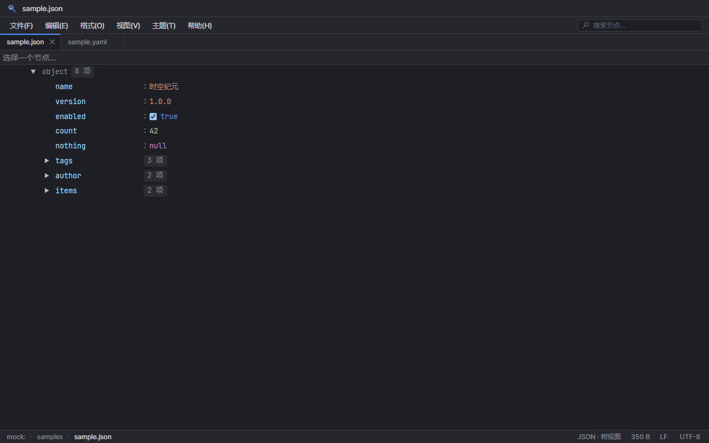

# CaDt-DataLens

> 十几 MB 安装包、30+ MB 免安装程序，塞进一整套 JetBrains 级开发体验与对标 DeepSeek Harness 的 AI Agent 宿主能力。单文件、零依赖、全本地。
> 面向 Windows 的轻量多格式数据查看与编辑器，也是可本地运行的 AI Agent 宿主（harness）。



技术栈：Go + Wails v3 + 原生 JS（Vite 构建），复用系统 WebView2 实现界面与内置浏览器，不打包 Chromium 与 Node。更新内容见 [CHANGELOG.md](CHANGELOG.md)。

## 我们要解决的问题

开发者日常要在「数据查看器、IDE、数据库客户端、AI Agent 宿主」之间来回切换，工具越装越多、体积越来越大、配置越来越繁琐，而数据上传云端又带来隐私顾虑；同时，AI Agent 的落地长期受困于工具链零散、权限与沙箱难配、多任务难编排。DataLens 用一个十几 MB 的本地绿色程序同时回答这些痛点——把看数据、改数据、跑数据与让 AI 接着干收进同一个轻量入口，开箱即用、全本地、隐私可控。

## 能力总览

### 1. Agent 宿主

内置丰富的工具调用与创新型 agent 基础设施：多终端设计（多会话独立终端，避免编码打架）、内置搜索工具、认知索引与文件大纲自动建立；内置 MCP 客户端与桌面控制能力；对齐主流 harness 的绝大部分能力——生命周期钩子、子代理沙盒、worktree 隔离、多智能体群聊圆桌、定时任务与计时器、会话分叉 / 回退、模型配额外显；打通内置浏览器标签页，对齐 harness 的浏览器操作体验；创新提供按依赖图调度的多会话编排生产线，以及基于 linear / ONNX 的端侧自动分类器。

完整细节见 [Agent 宿主能力](docs/features/agent-host.md)；生命周期钩子另见 [设计文档](docs/finished-plans/workspace-lifecycle-hooks.md)，编排见 [编排方案](docs/finished-plans/orchestration.md)，MCP 见 [MCP 客户端](docs/finished-plans/mcp-client.md) 与 [桌面 MCP](docs/finished-plans/desktop-mcp.md)。

### 2. 数据查看与开发

覆盖 JSON / JSONL、YAML、XML / SVG、CSV / TSV、TOML、INI、Markdown、几十种代码、图片音视频与二进制；同一文件可在树视图、代码视图（Ace，语法高亮 / 折叠 / 括号匹配）、纯文本、结构大纲、预览、百万行级虚拟滚动表格、SQL 查询间自由切换；代码补全、代码截图、多窗口多标签、Git 图谱、写作 / 阅读模式，全面对齐 JetBrains 使用体验；插件可扩展新格式与主题。

完整细节见 [数据查看与开发](docs/features/data-viewing.md)。

### 3. 一键运行

智能扫描本机解释器与编译器，F5 直接运行 Python / Node / Go / Java / C/C++ 等十余种语言，支持 stdin 交互、报错路径点击跳行与 GBK 转码；内置 Maven 工具窗口与 SQLite / MySQL / Redis 数据库客户端（默认只读、受控写入）。

完整细节见 [一键运行与数据库](docs/features/run-and-database.md)。

### 4. 数据安全

创新 patch 补丁机制（改动可审阅、可回滚）与环境变量自动注入，敏感值不落明文；四档权限配审批链，子代理命令跑在 Windows 受限令牌沙箱中、失败即拒；数据库默认只读、危险语句两阶段确认。

完整细节见 [数据安全与权限](docs/features/security.md)。

## 详细功能文档

上面四份文档收录了从 README 外迁的完整功能细节，按需查阅：

- [数据查看与开发](docs/features/data-viewing.md) — 格式与视图、编辑与文件、外观、多文件
- [一键运行与数据库](docs/features/run-and-database.md) — 运行代码、数据库客户端
- [Agent 宿主能力](docs/features/agent-host.md) — 生命周期钩子、AI 助手全量能力
- [数据安全与权限](docs/features/security.md) — 本地化、权限、补丁、worktree、沙箱、保守处理

更细的设计方案与决策记录在 [docs/finished-plans/](docs/finished-plans/)，开发约定见 [docs/repo-layout.md](docs/repo-layout.md) 与 [docs/core-capabilities.md](docs/core-capabilities.md)。

## 快捷键

| 操作 | 快捷键 |
| --- | --- |
| 新建 | `Ctrl+N` |
| 新建窗口 | `Ctrl+Shift+N` |
| 打开 | `Ctrl+O` |
| 保存 | `Ctrl+S` |
| 另存为 | `Ctrl+Shift+S` |
| 关闭标签 | `Ctrl+W` |
| 设置 | `Ctrl+,` |
| 撤销 / 重做 | `Ctrl+Z` / `Ctrl+Y` |
| 格式化 | `Ctrl+Alt+L` |
| 文件侧边栏 | `Ctrl+B` |
| 结构视图 | `Alt+7` |
| AI 会话侧边栏 | `Alt+8` |
| AI 助手面板 | `Alt+9` |
| AI 停止生成（输入框聚焦时） | 双击 `Esc` |
| 呼出 AI 浮窗（全局热键） | `Ctrl+Alt+A` |
| 呼出主窗口终端面板（全局热键） | `Ctrl+Alt+T` |
| 呼出调试控制台（全局热键） | `Ctrl+Alt+D` |
| 文件树中打开文件 / 展开目录 | 双击 |
| 文件树中选择 / 多选 | 单击 / `Ctrl+单击` |
| 文件树中连续选择 / 追加范围 | `Shift+单击` / `Ctrl+Shift+单击` |
| 文件树中重命名 | `F2` / `Shift+F6` |
| 文件树中删除（移到回收站） | `Delete` |
| 文件树中复制 / 剪切 / 粘贴 | `Ctrl+C` / `Ctrl+X` / `Ctrl+V` |
| 终端复制选中 / 粘贴 | `Ctrl+C`（有选中时）/ `Ctrl+Shift+V`；终端内右键也有复制 / 粘贴 / 清屏菜单 |
| 打开终端内链接（hover 有下划线） | `Ctrl+单击`（用系统默认程序打开） |
| 重新打开关闭的标签页 | `Ctrl+Shift+T` |
| Git 提交（打开提交面板） | `Ctrl+K` |
| Git 更新项目 | `Ctrl+T` |
| Git 推送 | `Ctrl+Shift+K` |
| Git 新建分支 | `Ctrl+Alt+N` |
| 当前文件在新窗口打开 | `Shift+F4` |
| 运行当前文件 | `F5` |
| 停止运行 | `Shift+F5` |
| 运行项目 | `Ctrl+F5` |
| 运行面板 | `Alt+F11` |
| 内容搜索 | `Ctrl+F`（代码/文本视图） |
| JSONPath 查询 | `Ctrl+Shift+J` |
| 切换行书签 / 跳到下一条 / 上一条 / 书签总览 | `F11` / `F2` / `Shift+F2` / `Shift+F11` |
| 快速切换 | Ctrl + 反引号 |
| 代码/文本视图转到行:列 | `Ctrl+G` |
| 展开 / 收起节点 | `Ctrl+=` / `Ctrl+-` |
| 全部展开 / 收起 | `Ctrl+Shift+=` / `Ctrl+Shift+-` |
| 调整编辑器字号 | `Ctrl+滚轮` |
| 调整 AI 助手字号 | `Ctrl+滚轮`（AI 面板内） |
| 标签栏横向滚动 | 鼠标滚轮悬停在标签栏 |

## 命令行

支持直接指定文件和行号，打开后切到代码视图（CSV 为文本视图）并整行选中：

```bat
CaDt-DataLens.exe "D:\data\sample.json:42"
CaDt-DataLens.exe "D:\data\sample.json:42:8"
CaDt-DataLens.exe "D:\data\sample.json" --line 42
CaDt-DataLens.exe --line 42 "D:\data\sample.json"
CaDt-DataLens.exe -g "D:\data\sample.json:42"
```

- 行、列从 1 开始；列可省略。
- 支持 `--line/-l`、`--column/-c`、`--goto/-g`。
- 可一次传多个文件；图片和二进制文件会忽略行号。
- **不存在的路径不再被静默忽略**：窗口照常置前并提示「打开失败」——打错路径时拿得到明确反馈。
- 程序已在运行时，新命令会转发到现有窗口并定位；**多窗口时文件按所属工作区路由**到对应窗口（祖先链最深命中，无归属投主窗口）。
- `--help`（`-h`）打印**完整参数帮助**（含下文 headless 子命令的用法）；`--version`（`-v`）打印版本号。
- `--memo "cadt-memo://workspace/item/it-xxx"`：接收快捷便签的**定位点**（在便签面板对分组/条目右键「复制定位点」得到，格式 `cadt-memo://<作用域>/<block|item>/<id>`）——直接打开便签面板跳转到该位置（折叠块自动展开并高亮），已在运行时同样转发。把定位点粘贴给 AI 助手，AI 也能按 id 立刻定位。
- `--ai-session=<id>`：打开指定 **AI 会话**；已在运行时转发到会话归属工作区的窗口。
- `--open-settings=<pane>`：直接打开设置页指定 pane（如 `models`、`ai`、`run`）。
- `--ai-float` 只开 AI 浮窗；`--debug-console` 只开调试控制台；`--quit` 优雅退出已运行的实例（无实例时静默退出）。

批量格式转换（隐藏窗口复用前端格式层，JSON ↔ JSONL ↔ YAML ↔ XML ↔ CSV ↔ TOML ↔ INI）：

```bat
CaDt-DataLens.exe --convert a.json --to yaml
CaDt-DataLens.exe --convert logs\*.jsonl --to csv --out dist\
CaDt-DataLens.exe --convert config.yaml --to json --stdout
```

- `--to` 支持 json / jsonl / yaml / xml / csv / toml / ini；默认在源文件旁生成同名新扩展名文件。
- `--out` 为已存在目录时按原文件名批量输出；为文件路径时只允许单个输入。
- `--stdout` 只输出内容（需要单个输入）；默认拒绝覆盖已有文件，加 `--force` 覆盖。
- 退出码：0 成功、1 转换失败、2 参数错误。

## 支持的文件类型

| 类型 | 扩展名 | 默认处理 |
| --- | --- | --- |
| JSON | `.json` `.jsonc` `.json5` | 树视图 / 代码视图 / 文本视图 |
| JSONL | `.jsonl` `.ndjson` | 树视图 / 代码视图 / 文本视图 |
| YAML | `.yaml` `.yml` | 树视图 / 代码视图 / 文本视图 |
| XML | `.xml` `.svg` | 树视图 / 代码视图 / 文本视图 |
| CSV | `.csv` `.tsv` | 表格视图 / 树视图 / 文本视图 |
| TOML | `.toml` | 树视图 / 代码视图 / 文本视图 |
| INI/Properties | `.ini` `.properties` `.cfg` | 树视图 / 代码视图 / 文本视图 |
| Markdown | `.md` `.markdown` | 预览 / 代码视图 / 文本视图 |
| Python | `.py` `.pyw` `.pyi` | 代码视图（缩进默认 4 空格） |
| Go | `.go` `.mod` `.work` `.sum` | 代码视图（缩进默认 Tab） |
| Web 前端 | `.html` `.css` `.js` `.ts` `.vue` 等 | 代码视图（HTML 另有预览 / 分屏） |
| C/C++ | `.c` `.h` `.cpp` `.hpp` 等 | 代码视图 |
| Java/Kotlin/C# | `.java` `.kt` `.cs` 等 | 代码视图 |
| Shell/Batch | `.sh` `.bash` `.bat` `.ps1` 等 | 代码视图 |
| Ruby/PHP/Lua 等 | `.rb` `.php` `.lua` 等 | 代码视图 |
| SQL | `.sql` | 代码视图 |
| 补丁 | `.patch` `.diff` | 补丁视图（结构化 hunk + 应用/撤销）/ 代码视图（diff 高亮 + 整行底色）/ 文本视图 |
| 文本 | `.txt` `.log` `.conf`、CMakeLists.txt / Makefile / Dockerfile / `.gitignore` 等 | 代码视图 |
| 图片 | `.png` `.jpg` `.jpeg` `.gif` `.bmp` `.webp` `.ico` `.tif` `.tiff` `.avif` `.heic` `.psd` 等 | 图片视图 / 二进制视图 |
| 其他 | 任意扩展名 | 文本按纯文本；含 NUL/大量控制字符按只读十六进制 |

## 示例数据

`docs/samples/` 按格式提供可直接打开的合成示例，说明见 [示例说明](docs/samples/README.md)。包含 12 层嵌套 JSON、JSONL 逐行记录、约 211 KB / 4944 个方块的长蓝图、长日志、CSV、SVG、TOML/INI 配置、带代码块和数学公式的 Markdown 示例，以及 PNG/JPEG/GIF/BMP/WebP/ICO/TIFF/AVIF 和原始字节等二进制样本。

## 构建

前置条件：

- Windows 10/11（需要 WebView2 Runtime）。
- Go 1.26+。
- Node.js 20.19+（或 22.12+）。
- Wails CLI v3.1.0+（`wails3`，用于生成 Windows 图标/清单资源）。

```bash
go install github.com/wailsapp/wails/v3/cmd/wails3@v3.1.0
git clone https://github.com/candysweet-cdt/CaDt-DataLens.git
cd CaDt-DataLens
powershell -ExecutionPolicy Bypass -File tools/rebuild-exe.ps1
```

脚本先跑 Go + 前端测试门，再构建 `build/bin/CaDt-DataLens.exe` 并替换仓库根目录的便携副本 `datalens.exe`。可以运行 `wails3 doctor` 检查环境。

构建变体：加 `-IncludeMCP` 会编译进 v3 内置 MCP server（外部 agent 经 Streamable HTTP 驱动应用界面，含 `js_eval` 等重权能工具），令牌与端点写入 `<应用数据目录>\mcp-server.json`；**标准构建完全不含该端点**，详见 [docs/finished-plans/app-mcp-server.md](docs/finished-plans/app-mcp-server.md)。

### 安装包

安装包使用 NSIS 构建（需先安装 [NSIS 3](https://nsis.sourceforge.io/) 并让 `makensis` 在 PATH 中）。完整的工具准备、版本号规则、升级/卸载行为、签名和发布检查清单见 **[打包与发布流程](docs/packaging.md)**。

```bash
tools\build-installer.cmd                                            # 双击或命令行运行：构建 + 代码签名 + 打包
tools\build-installer.cmd -SkipSign                                  # 跳过签名（本机试装）
```

产物在 `build/bin/CaDt-DataLens-amd64-installer.exe`，按当前用户安装到 `%LOCALAPPDATA%\Programs\CaDt-DataLens`，无需管理员权限。安装时可勾选文件关联、资源管理器右键菜单（默认勾选，写入 HKCU）、Agent Skill、用户 PATH、桌面快捷方式（默认不勾选）。安装包自动检测并静默安装 WebView2 运行时，创建开始菜单快捷方式和卸载项；覆盖安装沿用上次安装目录；卸载撤销注册表集成，但保留 `%APPDATA%\CandySweet\CaDt-DataLens` 下的配置和安装目录下的 `plugins\`。注册表集成由 `datalens.exe --integrate=... / --unintegrate=all` 完成，与程序内“设置 → 系统集成”共用同一套逻辑。

签名默认使用本机的开发自签名证书（FriendlyName `CaDt-DataLens Self-Signed (Dev)`）；正式发布用 `-Certificate D:\path\code-signing.pfx -CertificatePassword ...` 换成 CA 证书，`-SkipSign` 跳过签名。自签名只在加入本机“受信任根”后不报错，分发给其他人仍会提示“未知发布者”。

## 开发

```bash
go build -o datalens.exe . && ./datalens.exe
```

前端单独在浏览器里用 mock 数据调试：

```bash
cd frontend
npm install
npm run dev
```

打开 `http://localhost:5173/`。可用的 mock 场景：`?jsonl`、`?yaml`、`?xml`、`?csv`、`?text`、`?image`、`?line`、`?large`、`?invalid`、`?multi`、`?empty`、`?gbk`。mock 路径使用 `mock://samples/`，不会读写真实磁盘文件。

## 项目结构

```text
app_core.go                App 生命周期、启动参数、文件大小阈值、版本号
app_file.go                文件读写：编码检测、保存冲突校验、图片判定
app_fs.go                  目录与条目操作：列举、增删改移、落盘、对话框
app_window.go              脏标记、应用配置、多窗口与资源管理器定位
main.go                    Wails 配置、单实例/多窗口启动
app_test.go                Go 单元测试
run.go                     运行代码：准备临时副本、流式执行、GBK 解码
frontend/src/main.js       界面、标签页、设置、编辑器、文件菜单
frontend/src/run.js        运行代码：语言配方、运行面板、输出渲染
frontend/src/formats.js    格式驱动（JSON/JSONL/YAML/XML/CSV/文本/字节）
frontend/src/style.css     布局、Ace/jsoneditor 样式（主题色板在 core/themes.json）
frontend/index.html        窗口结构、菜单、设置对话框
frontend/public/vendor     jsoneditor 及图标资源
frontend/public/fonts      Inter / JetBrains Mono / Fira Code + OFL 许可
docs/screenshots           README 截图
```

## 已知限制

- 仅面向 Windows；未对 macOS/Linux 做验收。
- Windows 11 不允许程序静默修改默认打开方式，首次关联 `.json` 等类型需要在“打开方式”中手动选择本程序并勾选“始终”。
- 除了按图片识别的格式外，其他二进制文件会按纯文本展示（按设计）。
- 图片字节视图只展示前 1 MB。
- 在树视图编辑后再切到代码/文本视图或保存，会使用编辑器序列化后的格式；未编辑时保留原文件文本。
- 多窗口模式使用独立进程；窗口之间共享设置，但不会自动同步已经打开的文件列表。快捷便签与 AI 会话有跨进程写权租约：便签是单写者 + 只读副本；同一会话同一时刻只跑一个回合，另一个窗口会提示“正在另一窗口运行”，写者关闭后由 focus/watcher 自动接管或重读。
- 运行代码支持逐行 stdin 输入，但不是完整交互终端（无光标控制、无密码回显关闭等）；项目运行只执行探测出的固定命令，不会自动安装依赖或修改项目文件。
- 运行代码只跑当前单文件：不做工程构建，忽略 `go.mod` / `package.json` 里的项目级启动方式。
- AI 子代理的命令沙箱是**误操作兜底，不是隔离保证**：硬链接别名可绕过能力 SID，读操作与网络完全不受限，`read-only` 档下命令照样能联网、能读用户目录；沙箱内的 shell 是 PowerShell（Git Bash 在受限令牌下起不来）；写根必须是 NTFS 目录（FAT / exFAT 会让授权直接失败），首次授权要遍历整棵工作区树，目录很大时会有几十秒的等待；工作区被授权后会被打上 Low 完整性标签，此后其它以 Low IL 运行的进程也能写它——介意的话在 设置 → 权限 →「子代理命令沙箱」清除授权。

## 许可证

项目代码基于 **Apache License 2.0** 开源，详见 [LICENSE](LICENSE) 与 [NOTICE](NOTICE)。

第三方组件的完整许可说明见 [THIRD_PARTY_LICENSES.md](THIRD_PARTY_LICENSES.md)。

内置字体使用 SIL Open Font License 1.1，详见 [frontend/public/fonts/OFL.txt](frontend/public/fonts/OFL.txt)。
jsoneditor 使用 Apache License 2.0，详见 [frontend/public/vendor/LICENSE.jsoneditor](frontend/public/vendor/LICENSE.jsoneditor) 与 [NOTICE.jsoneditor](frontend/public/vendor/NOTICE.jsoneditor)。

主题中的产品名称（Darcula、IDEA 等）仅用于标识配色来源，本项目与 JetBrains 无隶属关系。

## 第三方组件

- [Wails v3](https://github.com/wailsapp/wails) — MIT
- [jsoneditor](https://github.com/josdejong/jsoneditor) — Apache-2.0
- [js-yaml](https://github.com/nodeca/js-yaml) — MIT
- [fast-xml-parser](https://github.com/NaturalIntelligence/fast-xml-parser) — MIT
- [Papa Parse](https://github.com/mholt/PapaParse) — MIT
- [Inter](https://github.com/rsms/inter) — OFL-1.1
- [JetBrains Mono](https://github.com/JetBrains/JetBrainsMono) — OFL-1.1
- [Fira Code](https://github.com/tonsky/FiraCode) — OFL-1.1
